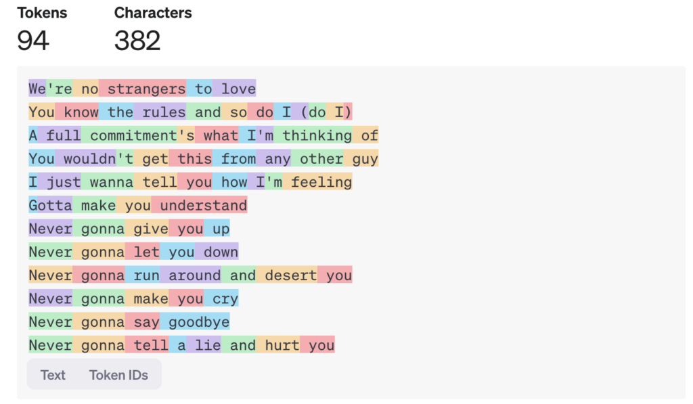
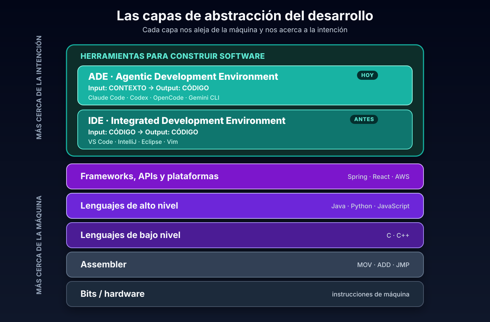
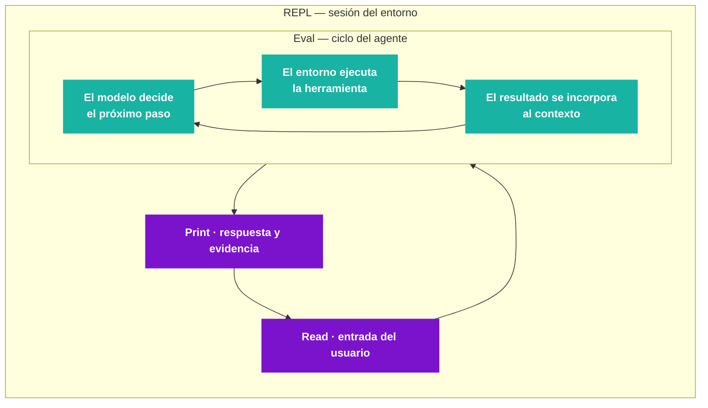

# Ingeniería de software con agentes de IA

**Apunte introductorio**

> **Parte I — Fundamentos**
>
> Autores: Alan Julián De Angelis y Luciano Rodriguez — Mercado Libre.
> Material complementario de la charla *El proceso del diseño empleando IA Generativa* (UTN).
> Versión: agosto de 2026.

## Sobre este apunte

Este documento es una guía de estudio para quienes ya programan y ya usan herramientas de IA de manera ocasional, y quieren pasar de un uso puntual a una práctica de ingeniería.

No es un manual de una herramienta específica. Los ejemplos usan Claude Code y Codex porque son representativos, pero los conceptos aplican a cualquier agente de desarrollo.

La Parte I establece los fundamentos: qué es un modelo de lenguaje en términos operativos, qué capa de abstracción introducen los agentes, cómo funciona su ciclo de ejecución y cuáles son sus límites.

## Índice

**Parte I — Fundamentos**

1. [Modelos de lenguaje: tokens y ventana de contexto](#capítulo-1--modelos-de-lenguaje-tokens-y-ventana-de-contexto)
2. [Capas de abstracción: del IDE al ADE](#capítulo-2--capas-de-abstracción-del-ide-al-ade)
3. [El ciclo de ejecución de un agente](#capítulo-3--el-ciclo-de-ejecución-de-un-agente)
4. [Límites de los agentes de desarrollo](#capítulo-4--límites-de-los-agentes-de-desarrollo)

---

# Capítulo 1 — Modelos de lenguaje: tokens y ventana de contexto

**Objetivos del capítulo**

- Definir qué es un modelo de lenguaje desde el punto de vista operativo, no teórico.
- Comprender la tokenización y sus consecuencias sobre el costo y el límite de contexto.
- Distinguir entre *prompt* y *contexto útil*.

## 1.1 Definición operativa

Un **LLM** (*Large Language Model*) es un modelo entrenado para predecir y generar lenguaje a partir de grandes volúmenes de texto y código. No “entiende” como una persona, pero reconoce patrones, infiere intención y produce artefactos: código, documentación, tests, comandos o análisis.

Para el desarrollo de software el punto relevante es que opera sobre las mismas representaciones que ya usamos a diario: código fuente, errores de compilación, logs, documentación, *issues*, *pull requests* y comandos de terminal. Eso convierte al lenguaje en una interfaz de trabajo.

## 1.2 Tokens

El modelo no procesa palabras ni caracteres: procesa **tokens**. Antes de cualquier inferencia, el texto se divide en fragmentos —una palabra completa, parte de una palabra, un signo o un espacio— y cada fragmento se traduce a un número.



En el ejemplo, 382 caracteres equivalen a **94 tokens**. La relación no es uniforme: `Never` constituye un token, mientras que `commitment's` se divide en varios.

De este mecanismo se derivan tres consecuencias prácticas:

1. **El costo se calcula por token.** Por eso los precios de los proveedores se expresan en dólares por millón de tokens, discriminando *input* y *output*.
2. **La ventana de contexto se mide en tokens.** Es el límite de información que el modelo puede considerar en una interacción.
3. **Todo lo que se envía ocupa espacio**: el código, los logs, los diffs, la documentación y el historial de la conversación.

## 1.3 Prompt y contexto útil

Conviene distinguir dos conceptos que suelen confundirse.

El **prompt** es la instrucción puntual: una pregunta, una orden o la descripción de una tarea.

El **contexto útil** es el conjunto de información que aumenta la probabilidad de que el agente tome buenas decisiones: objetivo de negocio, restricciones técnicas, arquitectura existente, patrones del repositorio, decisiones previas, ejemplos, tests disponibles y criterio de finalización.

Llenar la ventana de contexto no garantiza buenos resultados. Lo determinante no es el volumen de información, sino su pertinencia y su organización.

> **Idea central.** El trabajo profesional con agentes no consiste en escribir prompts más largos, sino en seleccionar mejor qué información entra en el contexto.

## Errores frecuentes

| Error | Por qué es un problema |
| --- | --- |
| Confundir extensión con calidad de contexto | Un prompt largo con información irrelevante compite con la instrucción principal y aumenta el costo. |
| Pegar logs o archivos completos sin filtrar | Consume miles de tokens que luego se pagan en cada interacción posterior de la misma sesión. |
| Suponer que el modelo conoce el proyecto | Sin información explícita, el modelo infiere convenciones a partir de patrones generales, no de los del repositorio. |

## Síntesis

1. Un LLM predice lenguaje y opera sobre las representaciones de trabajo habituales de la ingeniería de software.
2. La unidad de procesamiento es el token, no la palabra ni el carácter.
3. El costo y el límite de contexto se miden en tokens.
4. Prompt y contexto útil no son equivalentes: el segundo es el que determina la calidad del resultado.

---

# Capítulo 2 — Capas de abstracción: del IDE al ADE

**Objetivos del capítulo**

- Ubicar a los agentes de desarrollo dentro de la evolución histórica de las abstracciones.
- Caracterizar la diferencia funcional entre un IDE y un ADE.
- Identificar qué decisiones de ingeniería se desplazan hacia el desarrollador.

## 2.1 La escalera de abstracciones

El desarrollo de software avanzó agregando capas que alejan al programador de la máquina y lo acercan a la intención.



La capa superior —las herramientas con las que se construye software— es la que está en transformación. Durante décadas su exponente fue el **IDE** (*Integrated Development Environment*): editor, compilador, depurador y refactorizaciones en un entorno unificado. Actualmente se suma el **ADE** (*Agentic Development Environment*): entornos donde un agente opera sobre el proyecto. Pertenecen a esta categoría Claude Code, Codex, OpenCode y Gemini CLI, entre otros.

## 2.2 Diferencia funcional entre IDE y ADE

La distinción más operativa no está en las funcionalidades, sino en la naturaleza de la entrada.

| | IDE | ADE |
| --- | --- | --- |
| **Entrada** | Código escrito por la persona | Contexto: objetivo, restricciones, reglas y criterios de validación |
| **Salida** | Código | Código y evidencia de su funcionamiento |
| **Quién produce el código** | La persona; la herramienta asiste | El agente; la persona dirige y valida |
| **Unidad de trabajo** | El archivo abierto | La tarea completa sobre el repositorio |
| **Competencia central** | Dominio del lenguaje y de las herramientas | Diseño de contexto y validación de resultados |

> En un IDE la entrada es código y la salida es código. En un ADE la entrada es contexto y la salida es código.

La frontera entre categorías no es rígida: herramientas como Cursor o Windsurf son IDE que incorporaron capacidades agénticas. Lo relevante para el análisis no es la clasificación del producto, sino qué tipo de entrada produce el desarrollador.

## 2.3 Desplazamiento de las decisiones

Si la entrada del sistema es el contexto, la calidad del contexto se convierte en una competencia de ingeniería. El trabajo no desaparece: se desplaza hacia decisiones de mayor nivel.

- Definir qué se quiere construir y con qué alcance.
- Definir la **arquitectura del sistema**: capas, límites, responsabilidades y dependencias.
- Elegir los **patrones de diseño** adecuados y descartar los que no corresponden.
- Definir contratos e interfaces entre componentes.
- Establecer criterios de validación y evaluar *trade-offs*.
- Verificar la coherencia de la solución con el sistema existente.

Esta última responsabilidad es la más difícil de delegar. Un agente puede producir una solución que funciona de manera aislada pero que introduce un patrón ajeno al proyecto, duplica una abstracción existente o contradice una decisión arquitectónica previa. El código compila, los tests pasan y, aun así, el sistema se degrada.

## Errores frecuentes

| Error | Por qué es un problema |
| --- | --- |
| Usar un ADE como autocompletado avanzado | Se desaprovecha la capacidad de operar sobre la tarea completa y se mantiene el cuello de botella en la escritura manual. |
| Delegar decisiones de arquitectura al agente | El modelo optimiza la resolución local del problema, no la coherencia global del sistema. |
| Evaluar el resultado únicamente por “si funciona” | La compilación y los tests no detectan incoherencias de diseño ni duplicación de abstracciones. |

## Síntesis

1. Los agentes constituyen una nueva capa de abstracción sobre las herramientas de construcción de software.
2. El IDE recibe código y devuelve código; el ADE recibe contexto y devuelve código.
3. La competencia central se desplaza de escribir código a diseñar contexto y validar resultados.
4. Las decisiones de arquitectura, patrones y coherencia sistémica permanecen bajo responsabilidad humana.

---

# Capítulo 3 — El ciclo de ejecución de un agente

**Objetivos del capítulo**

- Describir el *agent loop* y su relación con el ciclo REPL del entorno.
- Explicar cómo el ciclo consume la ventana de contexto.
- Identificar las condiciones que determinan la finalización de una tarea.

## 3.1 Dos ciclos anidados

Un agente de desarrollo ejecuta dos ciclos, uno dentro del otro.

El ciclo externo es el **REPL** (*Read–Eval–Print Loop*) del entorno: lee la entrada del usuario, la evalúa, imprime el resultado y vuelve a esperar. Es lo que ocurre al ejecutar `claude` o `codex` en la terminal.

El ciclo interno se desarrolla dentro del paso **Eval**. Allí el SDK del proveedor interactúa con el modelo: envía el contexto, recibe solicitudes de herramientas, las ejecuta, incorpora los resultados y vuelve a invocar al modelo tantas veces como sea necesario.



La diferencia con un REPL clásico está en la naturaleza del paso `Eval`. En un intérprete de Python se evalúa una expresión de manera determinística en milisegundos; en un agente se ejecuta un ciclo completo de razonamiento, uso de herramientas y validación, con múltiples llamadas al modelo y resultados no determinísticos.

## 3.2 Las tres fases del ciclo interno

Dentro del `Eval`, el ciclo se organiza en tres fases que se alternan: **reunir contexto**, **actuar** y **validar**.

Una consulta sobre el código puede resolverse en la primera fase; la corrección de un error recorre las tres varias veces. La distribución depende de la tarea.

Existe una separación de responsabilidades que conviene retener:

- **El modelo decide** qué información falta, qué herramienta utilizar y cuándo detenerse.
- **El entorno ejecuta y restringe**: ejecuta la herramienta, aplica permisos y aislamiento, y devuelve el resultado al contexto.

De esta separación se desprende que dos agentes con el mismo modelo pueden rendir de manera muy distinta: la diferencia está en el entorno, no en el modelo.

## 3.3 Anatomía de un turno

La unidad de trabajo del ciclo interno es el **turno**: el modelo recibe el estado actual, decide, el entorno ejecuta las herramientas solicitadas y los resultados vuelven al contexto. El ciclo finaliza cuando el modelo responde sin solicitar herramientas.

Traza de ejecución para la consigna *“corregir los tests que fallan en `auth.ts`”*:

```text
Turno 1  → ejecuta npm test              → 3 tests fallan
Turno 2  → lee auth.ts y auth.test.ts    → analiza código y casos
Turno 3  → edita auth.ts y reejecuta     → los 3 tests pasan
Turno 4  → respuesta final, sin tools    → informa el resultado
```

Para el usuario esto constituye una única interacción del REPL. Internamente se produjeron cuatro ciclos de inferencia y ejecución.

## 3.4 Consumo de la ventana de contexto

El contexto **se acumula en ambos ciclos**: crece turno a turno dentro de un `Eval`, y lo acumulado persiste en las interacciones siguientes de la misma sesión.

| Componente | Incidencia |
| --- | --- |
| Instrucciones del sistema y del proyecto | Costo fijo, presente en cada solicitud |
| Definiciones de herramientas | Aumenta con cada integración conectada |
| Historial de la conversación | Crece de manera acumulativa |
| **Resultados de herramientas** | **El componente de mayor peso**: un archivo extenso o un log de integración continua puede consumir miles de tokens en un solo turno |

Cuando el contexto se aproxima al límite, el entorno realiza una **compactación**: descarta resultados antiguos y resume la conversación. El ciclo continúa, pero las instrucciones dadas al inicio pueden perderse en el resumen. Por ese motivo las reglas permanentes deben residir en archivos del proyecto —`CLAUDE.md`, `AGENTS.md`— y no en el primer mensaje de la conversación.

## 3.5 Condiciones de finalización

| Condición | Descripción |
| --- | --- |
| Respuesta sin solicitud de herramientas | El modelo considera cumplida la tarea |
| Límite de turnos | Tope de iteraciones configurado para el ciclo interno |
| Límite de presupuesto | Tope de costo antes de interrumpir |
| Permiso denegado o restricción del sandbox | La acción se bloquea y el modelo busca una alternativa o informa el bloqueo |
| Interrupción del usuario | Cancelación o redirección de la tarea |
| Error o agotamiento del contexto | Falla de herramienta, tiempo de espera agotado o imposibilidad de compactar |

La práctica recomendada es definir la finalización en términos verificables y no delegarla al criterio del modelo:

```text
Criterio de finalización:
- la suite de tests pasa;
- el análisis estático no reporta errores;
- el endpoint responde 201 y 400 según corresponda;
- el diff no modifica módulos fuera del alcance definido.
```

> Un agente no termina su trabajo cuando deja de emitir texto, sino cuando se verifica una condición externa.

## Errores frecuentes

| Error | Por qué es un problema |
| --- | --- |
| Acumular varias tareas en una misma sesión | El contexto no se reinicia entre interacciones: las tareas compiten por el mismo espacio y todas se degradan. |
| Colocar las reglas del proyecto en el primer mensaje | Se pierden durante la compactación; deben residir en archivos que el entorno reinyecta. |
| No definir criterio de finalización | El ciclo termina cuando el modelo lo decide, sin verificación externa. |
| Incorporar resultados de herramientas sin filtrar | Cada token incorporado se paga nuevamente en todos los turnos posteriores. |

## Síntesis

1. Un agente ejecuta dos ciclos anidados: el REPL del entorno y el ciclo del agente dentro del paso `Eval`.
2. El ciclo interno alterna tres fases: reunir contexto, actuar y validar.
3. El modelo decide y el entorno ejecuta y restringe; el rendimiento depende de ambos.
4. El contexto se acumula y obliga a compactar, lo que afecta la persistencia de las instrucciones.
5. La finalización debe definirse mediante condiciones verificables.

---

# Capítulo 4 — Límites de los agentes de desarrollo

**Objetivos del capítulo**

- Reconocer los límites estructurales de los agentes aplicados al desarrollo.
- Analizar las fallas frecuentes como problemas de diseño del ciclo y no del modelo.
- Fundamentar por qué la validación externa condiciona el nivel de delegación posible.

## 4.1 Límites estructurales

**Ventana de contexto acotada.** El agente no observa el sistema completo. Trabaja con fragmentos seleccionados y puede desconocer la arquitectura global del producto.

**Ausencia de conocimiento organizacional.** No conoce las integraciones internas, las APIs heredadas ni las decisiones de diseño que solo maneja el equipo. Puede generar código correcto en aislamiento e incorrecto en el sistema real.

**El producto no se reduce al código.** Un buen producto requiere considerar experiencia de usuario, escalabilidad, mantenibilidad, observabilidad y *trade-offs* técnicos. Esas dimensiones no se derivan automáticamente de la consigna.

**Confianza expresada con independencia de la corrección.** El modelo formula respuestas incorrectas con el mismo registro que las correctas. La seguridad del texto no constituye evidencia.

## 4.2 Las fallas como problemas del ciclo

Buena parte de los resultados deficientes no se explican por la capacidad del modelo, sino por deficiencias en el diseño del ciclo de trabajo:

- el contexto suministrado era insuficiente o irrelevante;
- un resultado de herramienta excesivamente extenso degradó el contexto disponible;
- la herramienta necesaria no estaba disponible o se utilizó una inadecuada;
- no existían permisos para ejecutar la validación;
- el objetivo estaba formulado de manera ambigua;
- no se definió una condición de finalización verificable.

Esta lectura es la más productiva desde el punto de vista de la ingeniería, porque todas esas causas son corregibles mediante decisiones de diseño.

## 4.3 Validación y delegación

De los límites anteriores se desprende el principio que organiza el resto del apunte: **el grado de autonomía que puede delegarse a un agente está determinado por la calidad de las señales de validación disponibles**.

Si el proyecto carece de tests, de comandos de verificación o de criterios de aceptación, la fase de validación del ciclo no puede ejecutarse y el resultado se acepta por confianza. Cuando esas señales existen, la delegación deja de basarse en la expectativa sobre el modelo y pasa a basarse en evidencia.

> La IA acelera el desarrollo, pero no reemplaza la ingeniería. Sin contexto, sin especificación y sin validación, acelera la producción de deuda técnica.

## Errores frecuentes

| Error | Por qué es un problema |
| --- | --- |
| Atribuir toda falla a la capacidad del modelo | Impide identificar las causas corregibles: contexto, herramientas, permisos y criterios de finalización. |
| Interpretar la seguridad de la respuesta como corrección | La formulación del texto es independiente de la validez técnica del resultado. |
| Delegar autonomía sin señales de validación | Sin verificación externa, la aceptación del resultado se apoya en la confianza y no en evidencia. |

## Síntesis

1. Los agentes presentan límites estructurales de contexto, conocimiento organizacional y visión de producto.
2. La mayoría de las fallas observadas son problemas de diseño del ciclo de trabajo, no de capacidad del modelo.
3. El nivel de autonomía delegable depende de la calidad de las señales de validación del proyecto.
4. La aceleración sin validación produce deuda técnica a mayor velocidad.

---

# Referencias

- Claude Code — *How Claude Code works*: el ciclo agéntico y las herramientas del entorno.
  <https://code.claude.com/docs/en/how-claude-code-works>

- Claude Agent SDK — *How the agent loop works*: turnos, mensajes, compactación y límites de ejecución.
  <https://code.claude.com/docs/en/agent-sdk/agent-loop>

- Anthropic — *Building effective agents*.
  <https://www.anthropic.com/engineering/building-effective-agents>

- Anthropic — *Effective context engineering for AI agents*.
  <https://www.anthropic.com/engineering/effective-context-engineering-for-ai-agents>

- OpenAI Codex — *Agent approvals and security*: aislamiento y políticas de aprobación.
  <https://developers.openai.com/codex/agent-approvals-security>

- OpenAI Tokenizer — herramienta para visualizar la tokenización de un texto.
  <https://platform.openai.com/tokenizer>
