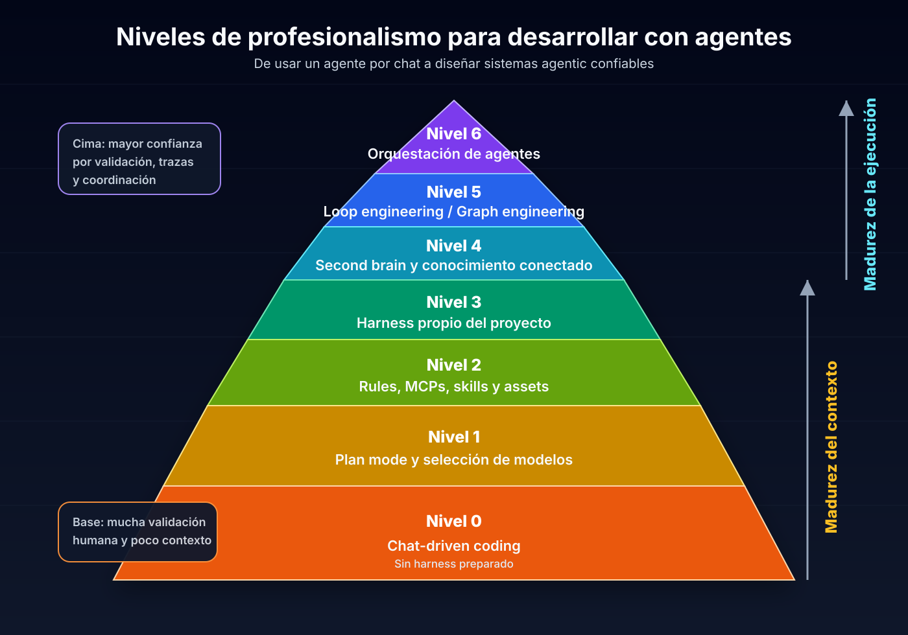
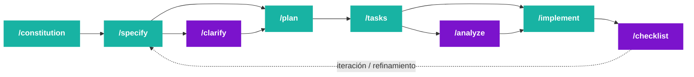

# Charla GenAI UTN — Material

> Fuente inicial: `Charla-GenAI-UTN-Material.docx`  
> Estado: primera versión editada y estructurada en Markdown.  
> Objetivo: material base para preparar charla, slides, speaker notes y demos.

## Título

**El proceso del diseño empleando IA Generativa**

Cómo dirigir agentes de desarrollo para generar software escalable, predecible y de calidad.

Técnicas que usan equipos de ingeniería modernos: **Context Engineering**, **Spec-Driven Development**, **harnesses de proyecto**, **skills**, **MCP** y **second brain**.

## Oradores

- **Alan Julián De Angelis** — GenAI Technical Leader, Mercado Libre.
- **Luciano Rodriguez** — GenAI Software Engineer, Mercado Libre.

## Índice

1. [Introducción](#introducción)
2. [Marco inicial: LLMs, coding agents y nueva abstracción](#marco-inicial-llms-coding-agents-y-nueva-abstracción)
3. [Apertura: el nuevo ciclo de desarrollo](#1-apertura-el-nuevo-ciclo-de-desarrollo)
4. [Por qué la IA sola no alcanza](#2-por-qué-la-ia-sola-no-alcanza)
5. [Niveles de profesionalismo para desarrollar con agentes](#3-niveles-de-profesionalismo-para-desarrollar-con-agentes)
6. [Modelos para coding agents](#4-modelos-para-coding-agents)
7. [Herramientas útiles para ampliar las capacidades del agente](#5-herramientas-útiles-para-ampliar-las-capacidades-del-agente)
8. [Context Engineering](#6-context-engineering)
9. [Spec-Driven Development](#7-spec-driven-development-sdd)
10. [Orquestación de agentes](#8-orquestación-de-agentes)
11. [Cierre](#9-cierre)
12. [Referencias](#10-referencias)

---

# Introducción

El rol del ingeniero de software evolucionó con la llegada de la IA generativa: de escribir código a **diseñar contexto**, **dirigir agentes** y **tomar decisiones de mayor valor**.

La tesis central de la charla es que el valor de desarrollar software de calidad se duplicó, porque ahora no alcanza con dominar ingeniería de software: también hay que aprender a dirigir los agentes que ejecutan parte de ese trabajo.

> **Tesis central:** “El valor de desarrollar software de calidad se ha duplicado.”

## Marco inicial: LLMs, coding agents y nueva abstracción

Antes de hablar de contexto, MCPs, skills o flujos avanzados, conviene alinear una idea base: ¿qué es exactamente lo que cambió con los LLMs y por qué eso modifica la forma de desarrollar software?

### Qué es un LLM

Un **LLM** (*Large Language Model*) es un modelo entrenado para predecir y generar lenguaje a partir de grandes volúmenes de texto y código. En términos prácticos, no “entiende” como una persona, pero sí puede reconocer patrones, inferir intención, resumir, transformar información, explicar conceptos y producir artefactos útiles: código, documentación, tests, comandos, planes o análisis.

Para un equipo de desarrollo, el punto importante no es que el LLM sea una enciclopedia. El punto importante es que puede operar sobre representaciones de trabajo que ya usamos todos los días:

- lenguaje natural;
- código fuente;
- errores de compilación;
- logs;
- documentación;
- issues;
- pull requests;
- comandos de terminal;
- contratos técnicos y reglas de negocio.

Esto convierte al lenguaje en una interfaz de trabajo. Ya no solo escribimos instrucciones para personas o código para máquinas: también escribimos contexto para modelos.

### Qué es un coding agent

Un **coding agent** es una capa por encima del LLM que lo conecta con un entorno de desarrollo real.

Un chatbot puede responder una pregunta sobre código. Un coding agent puede interactuar con el proyecto:

- leer archivos del repositorio;
- buscar referencias;
- modificar código;
- crear tests;
- ejecutar comandos;
- observar errores;
- corregir cambios;
- validar resultados;
- preparar un diff o un PR.

La diferencia no es menor. En un chatbot, el modelo conversa. En un coding agent, el modelo participa dentro de un **loop de trabajo**.

```text
Objetivo del usuario
  ↓
Contexto del proyecto
  ↓
Decisión del modelo
  ↓
Uso de herramientas
  ↓
Observación del resultado
  ↓
Validación
  ↓
Nueva decisión
```

Herramientas como **Claude Code**, **Codex**, Cursor, Windsurf o GitHub Copilot Agent Mode llevan al modelo desde la conversación hacia el entorno donde el software realmente vive: el repositorio, la terminal, los tests, los linters, los pull requests y la documentación.

### La nueva capa de abstracción

Históricamente el desarrollo de software fue sumando capas de abstracción:

```text
Bits / hardware
  ↓
Assembler
  ↓
Lenguajes de alto nivel
  ↓
Frameworks
  ↓
APIs y plataformas
  ↓
Agentes de desarrollo guiados por lenguaje natural
```

Los coding agents agregan una nueva capa: el desarrollador ya no solo escribe cada instrucción del sistema, sino que también **dirige una entidad capaz de ejecutar parte del trabajo técnico**.

Eso no elimina la ingeniería. La desplaza hacia decisiones de mayor nivel:

- definir qué se quiere construir;
- explicar el contexto correcto;
- acotar el alcance;
- elegir herramientas;
- establecer criterios de validación;
- revisar trade-offs;
- decidir cuándo aceptar, corregir o descartar una solución.

En otras palabras: el ingeniero deja de ser únicamente quien escribe código línea por línea y empieza a ser también quien diseña el entorno para que otro actor —el agente— pueda producir código con calidad.

### Del prompt al contexto útil

A partir de esta nueva capa aparece una distinción central para la charla: **prompt no es lo mismo que contexto útil**.

Un prompt es la instrucción que se le da al modelo. Puede ser una pregunta, una orden o una descripción de tarea.

El contexto útil es todo aquello que aumenta la probabilidad de que el agente tome buenas decisiones:

- objetivo de negocio;
- restricciones técnicas;
- arquitectura existente;
- patrones del repositorio;
- decisiones previas;
- ejemplos buenos y malos;
- tests disponibles;
- errores conocidos;
- documentación interna;
- criterio de finalización.

La **ventana de contexto** es el límite técnico de información que el modelo puede considerar en una interacción. Pero llenar esa ventana con texto no garantiza buenos resultados. Lo importante no es solamente cuánto contexto entra, sino qué tan bien está seleccionado, ordenado y conectado con la tarea.

> **Idea clave:** el trabajo profesional con agentes no consiste en escribir prompts más largos, sino en diseñar mejor contexto útil.

### Tools: cuando el agente deja de adivinar

Las **tools** son el mecanismo que permite que el agente interactúe con el entorno en vez de depender solo de lo que recuerda o infiere.

Con tools, el agente puede:

- inspeccionar el código real;
- ejecutar tests;
- leer logs;
- consultar documentación;
- llamar APIs;
- abrir issues;
- revisar diffs;
- verificar si una hipótesis era correcta.

Esto cambia la dinámica: el modelo no necesita imaginar el estado del sistema; puede observarlo. Y si puede observarlo, puede iterar.

Por eso un coding agent como Claude Code puede resolver tareas de desarrollo: no porque el LLM “sepa todo”, sino porque el harness le permite:

1. recibir un objetivo;
2. leer contexto relevante;
3. usar herramientas;
4. modificar el entorno;
5. validar con evidencia;
6. repetir hasta cumplir una condición de parada.

### Puente hacia el resto de la charla

Desde esta base se entiende mejor el resto del material.

Primero aparece el problema del **contexto**: qué información necesita el agente y cómo se la damos.

Luego aparecen los mecanismos para profesionalizar ese contexto:

- reglas del proyecto;
- archivos `AGENTS.md` o equivalentes;
- documentación viva;
- skills;
- MCPs;
- herramientas de terminal;
- validaciones automáticas;
- especificaciones;
- second brain;
- harnesses de proyecto.

La pregunta central deja de ser “¿qué prompt uso?” y pasa a ser:

> **¿Qué sistema de trabajo construyo para que el agente pueda producir buen software de forma consistente?**

## Lectura de la audiencia

La audiencia ya usa IA, pero principalmente como asistencia puntual:

- para tareas repetitivas como CRUDs, DTOs o boilerplate cuando el patrón ya es conocido;
- para destrabarse cuando no saben cómo comenzar una funcionalidad;
- desde ChatGPT o Claude en navegador, más que integrada al IDE o al repo;
- como “juez” para cuestionar decisiones o revisar una solución;
- para organizarse con planes paso a paso antes de implementar.

Eso ubica a la mayoría entre **Nivel 0** y **Nivel 1** de la pirámide: ya existe el hábito, pero todavía falta convertirlo en un flujo de ingeniería más estructurado.

La clase debería partir de ese punto real: no vender autonomía extrema desde el minuto uno, sino mostrar cómo pasar de uso puntual a uso profesional mediante **mejor contexto, mejores contratos de trabajo y validación externa**.

> **Mensaje para esta audiencia:** no están usando mal la IA; están usando la primera versión del hábito. El siguiente paso es profesionalizarlo.

---

# 1. Apertura: el nuevo ciclo de desarrollo

Hoy contamos con una nueva capa de abstracción: **agentes de IA capaces de escribir, modificar, probar y revisar código**.

Pero esta nueva capa abre dos caminos muy distintos.

## Los dos caminos

### Camino fácil: vibe-coding

Delegar tareas al agente con prompts simples y esperar que “resuelva”.

En la práctica suele traer:

- muchas iteraciones;
- calidad por debajo de lo esperado;
- pérdida de contexto;
- correcciones largas;
- soluciones que funcionan en aislamiento pero no encajan bien en el sistema real.

### Camino que escala: desarrollo estructurado

Trabajar con:

- especificaciones como contrato;
- validaciones básicas y checklist como evidencia externa;
- contexto diseñado explícitamente;
- comandos, skills y flujos repetibles;
- documentación viva del proyecto;
- revisión humana en puntos críticos;
- agentes configurados con límites, tools y permisos claros.

## Mensaje clave

El valor del software de calidad se duplicó porque el ingeniero debe estar en los detalles y pensar tanto en el producto como en lo técnico.

La nueva responsabilidad es preparar a esta capa de abstracción para que construya exactamente lo que se necesita, sin degradar la salud del sistema.

---

# 2. Por qué la IA sola no alcanza

Los agentes de IA, usados de forma aislada, tienen límites que impiden entregar software de calidad por sí solos.

## Límites principales

### Ventana de contexto limitada

No pueden ver el sistema completo. Trabajan con fragmentos y no siempre entienden la arquitectura global del producto.

### Capacidades acotadas

Pueden generar código correcto en aislamiento, pero desconocen reglas de negocio, restricciones reales y decisiones previas del equipo.

### Conocimiento empresarial ausente

No conocen integraciones internas, APIs legacy ni decisiones de diseño que solo el equipo maneja.

### Producto ≠ código

Un buen producto necesita visión de conjunto: UX, escalabilidad, mantenibilidad, observabilidad y trade-offs técnicos. Los agentes no piensan automáticamente como product engineers.

## Conclusión

La IA puede acelerar el desarrollo, pero no reemplaza la ingeniería. Sin contexto, sin especificaciones y sin validación, solo acelera la producción de deuda técnica. Un destino pintoresco, aunque poco recomendable.

---

# 3. Niveles de profesionalismo para desarrollar con agentes

Una forma práctica de entender la adopción de agentes es pensarla como una pirámide de madurez: en la base está el uso conversacional, y a medida que se asciende aparecen contexto persistente, validación, loops, grafos, evals y orquestación.

En esta charla el foco práctico llega hasta los **niveles 3/4**. Los niveles 5, 6 y 7 quedan como mapa de hacia dónde evoluciona la práctica, no como contenido central.

La pirámide tiene dos fuerzas que crecen en paralelo:

- **Madurez del contexto:** cuánto entiende el agente del proyecto, del negocio, de las reglas y de la historia técnica.
- **Madurez de la ejecución:** qué tan bien puede planificar, actuar, validar, iterar y coordinarse con otros agentes.



> **Idea clave:** cuanto más arriba se está en la pirámide, más confianza se puede delegar en el agente. Esa confianza no nace de la fe en el modelo, sino de mejores restricciones, mejor contexto y mejores señales de validación.

## Nivel 0 — Chat-driven coding

Uso inicial de un coding agent como Claude, Codex, Cursor o similares, sin un harness preparado.

**Hay:**

- conversación directa con el agente;
- explicación manual de la tarea;
- feedback humano constante;
- validación principalmente visual o manual;
- productividad inicial alta para tareas simples.

**No hay:**

- contexto persistente del proyecto;
- rules, `AGENTS.md` o `CLAUDE.md`;
- plan formal antes de implementar;
- comandos de validación definidos;
- memoria de decisiones previas;
- límites claros de permisos o herramientas.

Es el nivel del **vibe-coding**: útil para empezar, peligroso si se confunde velocidad con calidad. El agente puede avanzar rápido, pero también puede acelerar deuda técnica con admirable entusiasmo.

## Nivel 1 — Planificación y selección consciente de modelos

El usuario empieza a dirigir el trabajo: primero se planifica, luego se ejecuta. También se elige el modelo según el tipo de tarea.

**Hay:**

- uso de plan mode antes de tocar código;
- división de tareas complejas en pasos verificables;
- elección consciente entre modelos rápidos, balanceados y de máxima capacidad;
- revisión humana frecuente antes de implementar;
- mayor control sobre costo, velocidad y profundidad de razonamiento.

**No hay:**

- workflows reutilizables;
- automatización del proceso;
- memoria estable del proyecto;
- integración profunda con herramientas externas;
- validación sistemática más allá de lo que el usuario pida manualmente.

Ejemplos de elección de modelos:

- **Pregunta simple:** “¿Dónde está definida esta función?” o “¿Qué comando corre los tests?” → modelo rápido/barato.
- **Tarea repetitiva:** “Agregá tests similares para estos tres casos” o “Actualizá este patrón en varios archivos” → modelo balanceado.
- **Tarea compleja:** “Diseñá la migración de este módulo sin romper compatibilidad” o “Investigá un bug intermitente de producción con impacto arquitectónico” → modelo de máxima capacidad.

## Nivel 2 — Rules, MCPs, skills y assets reutilizables

El trabajo deja de depender exclusivamente del prompt del momento. Se empiezan a empaquetar reglas, herramientas y conocimiento operativo.

**Hay:**

- rules de comportamiento y estilo;
- archivos como `AGENTS.md` o `CLAUDE.md`;
- MCPs para conectar herramientas externas;
- skills para workflows repetidos;
- assets, templates, scripts y checklists;
- instrucciones reutilizables para testing, debugging, documentación o code review.

**No hay:**

- harness completo y mantenido como parte central del proyecto;
- contexto de negocio suficientemente vivo;
- estrategia clara de memoria a largo plazo;
- observabilidad profunda del proceso del agente;
- autonomía confiable para tareas largas.

La diferencia central es que el conocimiento empieza a dejar de estar solo en la cabeza del developer y pasa a vivir en artefactos que el agente puede reutilizar.

## Nivel 3 — Harness propio del proyecto

El proyecto ya tiene un entorno diseñado para que el agente trabaje bien. Acá aparece con más fuerza el **Context Engineering**.

**Hay:**

- harness propio del repo;
- contexto vivo del proyecto;
- documentación técnica relevante;
- reglas de negocio;
- comandos de validación;
- criterios de arquitectura;
- subagents para investigación, testing, documentación o revisión;
- hooks para ejecutar acciones determinísticas en momentos críticos.

**No hay:**

- memoria externa amplia tipo second brain;
- recuperación histórica sofisticada;
- loops o grafos diseñados explícitamente para tareas largas;
- orquestación multi-agente completa;
- autonomía alta sin supervisión humana.

En este nivel la persona sigue validando activamente, pero el agente ya opera con un mapa mucho más fiel del proyecto. El salto de calidad no viene de “prompt mágico”, sino de darle al agente un entorno menos improvisado.

## Nivel 4 — Second brain y conocimiento externo conectado

El agente deja de depender solo del repo y puede consultar una base de conocimiento viva: Obsidian, Notion, Google Drive, ADRs, RFCs, research notes o documentación interna.

**Hay:**

- conexión con un second brain;
- acceso a decisiones pasadas;
- contexto de negocio persistente;
- investigación acumulada;
- documentación histórica;
- posibilidad de recuperar aprendizajes entre sesiones.

**No hay:**

- garantía automática de calidad del conocimiento recuperado;
- loops autónomos robustos;
- coordinación multi-agente avanzada;
- validación completa sin intervención humana.

Este nivel aumenta la confianza porque el agente puede trabajar con historia, no solo con instrucciones del momento. Pero exige curaduría: una base de conocimiento desordenada no es memoria, es ruido con pretensiones académicas.

## Nivel 5 — Loop engineering y graph engineering

El foco pasa de “qué contexto tiene el agente” a “cómo ejecuta”. Se diseñan ciclos y topologías explícitas para resolver tareas largas o ambiguas.

**Hay:**

- loops de ejecución: analizar → actuar → observar → corregir;
- condiciones de salida verificables;
- retries y presupuestos de iteración;
- manejo de fallos;
- trazas del proceso;
- grafos con nodos, estados, ramas y handoffs.

**No hay:**

- necesariamente múltiples agentes especializados;
- evals sistemáticos como práctica central;
- coordinación distribuida compleja;
- confianza plena sin monitoreo;
- reemplazo del criterio humano en decisiones críticas.

La frase importante para este nivel:

> Un agente serio no termina cuando deja de hablar. Termina cuando una condición verificable se cumple.

## Nivel 6 — Evals y validación sistemática

En este nivel la calidad deja de depender de la percepción humana inmediata y empieza a medirse con señales repetibles.

**Hay:**

- evals del agente y de su harness;
- tests, builds, linters y type checks como señales externas;
- criterios de aceptación medibles;
- observabilidad del proceso;
- comparación entre modelos, prompts, skills y herramientas;
- evidencia para decidir cuánta autonomía se puede delegar.

**No hay:**

- garantía absoluta de calidad;
- eliminación del criterio humano;
- orquestación multi-agente completa;
- autonomía ilimitada sin límites de permisos, costos y riesgos.

Este nivel es importante, pero queda fuera del alcance principal de esta charla. Lo mencionamos como frontera natural: antes de delegar más, hay que medir mejor.

## Nivel 7 — Orquestación de agentes

El nivel superior es diseñar un sistema donde múltiples agentes trabajan con roles, límites y responsabilidades claras.

**Hay:**

- agentes especializados por rol;
- paralelización de tareas;
- handoffs entre agentes;
- separación entre planificación, implementación, testing, evals y revisión;
- agentes revisores o críticos;
- coordinación de costos, permisos y contexto;
- mayor confianza operativa basada en validación y trazabilidad.

**No hay:**

- magia;
- garantía de calidad por sumar más agentes;
- independencia total del diseño humano;
- reemplazo de arquitectura, producto o criterio técnico.

Orquestar agentes no significa sumar inteligencia de forma lineal. Significa diseñar coordinación. Un solo agente bien equipado puede ser mejor que cinco agentes mal coordinados corriendo en direcciones distintas, una imagen épica, pero poco recomendable para producción.

## Lectura de la pirámide

Los primeros niveles fortalecen la **madurez del contexto**: el agente entiende mejor qué debe hacer, con qué reglas, en qué proyecto y con qué conocimiento.

Los niveles superiores fortalecen la **madurez de la ejecución**: el agente no solo entiende mejor, sino que trabaja con loops, evals, coordinación y trazabilidad.

La profesionalización ocurre cuando se combinan ambas dimensiones:

> mejor contexto para decidir, mejor ejecución para actuar y mejor validación para confiar.

## Señales prácticas tomadas de la investigación en X

La investigación sobre buenas prácticas de agentes refuerza una idea transversal: **el modelo no es el sistema**. El agente útil aparece cuando se diseña el entorno donde el modelo trabaja.

Las señales más repetidas fueron:

- **Contexto antes que prompt:** explicar objetivo, restricciones, definición de buen resultado y reglas del proyecto.
- **Plan antes que código:** usar plan mode o specs para tareas con ambigüedad o impacto arquitectónico.
- **Artefactos persistentes:** guardar instrucciones repetidas en `AGENTS.md`, `CLAUDE.md`, rules, skills o documentación del repo.
- **Tools con criterio:** MCP y herramientas externas expanden capacidad, pero también aumentan permisos, costos de contexto y superficie de riesgo.
- **Validación externa:** incluso dentro del alcance de esta charla, checklist, tests, builds y linters valen más que la frase “listo” del modelo.
- **Memoria curada:** un second brain ayuda solo si la información está ordenada, actualizada y pensada para ser recuperada.

La conclusión operativa es simple: subir en la pirámide no significa escribir prompts más largos, sino diseñar mejores **contratos de trabajo** para el agente.

Fuentes externas leídas para esta síntesis:

- **ChatGPT Learn — Best practices:** recomienda tratar a Codex menos como asistente de una sola vez y más como un teammate que se configura y mejora con el tiempo.
- **OpenAI — Harness Engineering:** muestra que el cuello de botella deja de ser escribir código y pasa a ser diseñar entornos, especificar intenciones y crear bucles de feedback para que los agentes trabajen de forma fiable.

---

# 4. Modelos para coding agents

Elegir el modelo correcto es parte del diseño del harness. No todos los problemas justifican usar el modelo más caro: muchas tareas son de búsqueda, edición mecánica o validación, y pueden resolverse con modelos rápidos o balanceados. Reservar los modelos premium para decisiones difíciles es disciplina económica, no austeridad heroica.

> **Regla práctica:** usar el modelo más barato que pueda resolver la tarea con confiabilidad suficiente, y subir de modelo cuando aumentan ambigüedad, riesgo, impacto arquitectónico o necesidad de razonamiento largo.

## Familias principales para desarrollo

### Codex / OpenAI

Codex está pensado para trabajar como agente de ingeniería sobre repositorios: leer código, modificar archivos, ejecutar comandos, correr tests y colaborar en flujos de PR.

**Cuándo usarlo:**

- tareas de implementación bien especificadas;
- refactors acotados;
- generación o reparación de tests;
- navegación de repositorios grandes;
- automatización desde CLI;
- flujos donde conviene que el agente ejecute comandos y verifique resultados.

**Buen uso:** darle un objetivo claro, archivos relevantes, restricciones y un comando de validación. Codex rinde mucho mejor cuando puede actuar sobre un repo real, no solo responder en abstracto.

### Claude / Claude Code

Claude Code se destaca como coding agent interactivo para razonar sobre arquitectura, editar proyectos y mantener conversaciones largas con buen manejo de contexto. Dentro de Claude, la elección típica es entre Haiku, Sonnet y Opus.

**Cuándo usarlo:**

- análisis de arquitectura o diseño técnico;
- debugging donde hay que sostener varias hipótesis;
- escritura y revisión de specs;
- refactors con impacto amplio;
- code review profundo;
- documentación técnica y explicación de trade-offs.

**Buen uso:** usar Sonnet como modelo de trabajo diario, Haiku para tareas rápidas y Opus para problemas donde el costo extra se justifica por complejidad o riesgo.

## Matriz de decisión rápida

| Tipo de tarea | Modelo recomendado | Motivo |
| --- | --- | --- |
| Buscar dónde vive una función, explicar un error simple o resumir un archivo | Haiku / modelo rápido | Bajo costo y latencia; no requiere razonamiento profundo. |
| Agregar tests similares, cambiar un patrón en pocos archivos, actualizar documentación | Sonnet / Codex estándar | Buen balance entre costo, calidad y ejecución. |
| Implementar una feature con spec clara y tests definidos | Codex estándar o Sonnet | Importa más el harness y la validación que usar el modelo más caro. |
| Debugging complejo, migración delicada, diseño de arquitectura o decisiones con muchas restricciones | Opus / modelo premium | El costo se justifica si reduce errores caros o retrabajo. |
| Revisión final de un cambio grande | Sonnet u Opus según riesgo | Conviene pagar más cuando el error puede afectar producción. |
| Tareas masivas repetitivas | Modelo barato + scripts determinísticos | Si la tarea es mecánica, no conviene quemar tokens premium. |

## Tabla visual de precios

Precios públicos consultados el **2026-08-11**. Los valores están expresados en **USD por 1 millón de tokens**. Pueden cambiar; en documentación viva conviene linkear siempre la fuente oficial.

### OpenAI / Codex

| Modelo | Input | Input cacheado | Output | Nota de uso |
| --- | ---: | ---: | ---: | --- |
| `gpt-5.3-codex` — estándar | USD 1.75 | USD 0.175 | USD 14.00 | Modelo principal para tareas de coding agent en Codex. |
| `gpt-5.3-codex` — Fast mode | USD 3.50 | USD 0.35 | USD 28.00 | Más caro; útil cuando la latencia importa más que el costo. |

### Anthropic / Claude

| Modelo | Input base | Cache write 5m | Cache write 1h | Cache hit / refresh | Output | Nota de uso |
| --- | ---: | ---: | ---: | ---: | ---: | --- |
| Claude Haiku 4.5 | USD 1.00 | USD 1.25 | USD 2.00 | USD 0.10 | USD 5.00 | Rápido y económico; ideal para tareas simples, clasificación, resúmenes o checks livianos. |
| Claude Sonnet 5 — precio introductorio hasta 2026-08-31 | USD 2.00 | USD 2.50 | USD 4.00 | USD 0.20 | USD 10.00 | Excelente modelo diario si está disponible a precio promocional. |
| Claude Sonnet 5 — desde 2026-09-01 | USD 3.00 | USD 3.75 | USD 6.00 | USD 0.30 | USD 15.00 | Balance fuerte para coding, specs, debugging y revisión. |
| Claude Sonnet 4.6 / 4.5 | USD 3.00 | USD 3.75 | USD 6.00 | USD 0.30 | USD 15.00 | Modelo de trabajo diario cuando se busca calidad consistente. |
| Claude Opus 5 / 4.5 | USD 5.00 | USD 6.25 | USD 10.00 | USD 0.50 | USD 25.00 | Premium; reservar para problemas complejos o de alto riesgo. |
| Claude Fable 5 / Mythos 5 | USD 10.00 | USD 12.50 | USD 20.00 | USD 1.00 | USD 50.00 | Muy caro; usar solo si el valor de la tarea justifica razonamiento extremo o agentes largos. |

## Lectura económica

- El **output suele ser mucho más caro** que el input. Pedir respuestas largas, logs completos o reescrituras enormes puede multiplicar el costo.
- El **cache** puede bajar mucho el costo cuando se reutiliza contexto estable: rules, specs, instrucciones del repo o documentación base.
- El modo rápido puede duplicar precio. Sirve para urgencia, no como default.
- En tareas grandes, el costo real no es solo el modelo: también cuentan loops, retries, herramientas, contexto innecesario y conversaciones eternas.

La conclusión para la charla: profesionalizar agentes también implica **gestionar presupuesto de razonamiento**. No todo merece Opus; no todo debe hacerse con el modelo más barato. El criterio está en elegir la herramienta justa para el riesgo correcto.

---

# 5. Herramientas útiles para ampliar las capacidades del agente

Un agente mejora mucho cuando puede usar herramientas reales del entorno de desarrollo. El modelo razona; las herramientas observan, ejecutan y verifican. Sin tools, el agente opina. Con tools bien configuradas, el agente puede operar sobre evidencia.

## Principio: darle terminales seguras, no permisos infinitos

La clave no es conectar todo, sino conectar lo necesario con permisos claros. Cada herramienta debería responder a una pregunta simple:

> ¿Esta integración permite que el agente lea mejor, actúe mejor o valide mejor?

Si la respuesta es no, probablemente sea decoración técnica. Y la decoración técnica, como todo ornamento en Mordor, termina pesando.

## GitHub CLI — `gh`

`gh` es una de las herramientas más valiosas para coding agents porque convierte GitHub en una interfaz operable desde terminal.

Permite que el agente pueda:

- leer issues y PRs;
- revisar comentarios de reviewers;
- ver diffs;
- crear PRs;
- comentar avances;
- listar checks de CI;
- leer logs de workflows;
- hacer checkout de PRs existentes;
- preparar resúmenes de cambios;
- automatizar el ciclo branch → commit → PR → checks → fixes.

Ejemplos útiles:

```bash
gh pr view 123 --comments
gh pr diff 123
gh pr checkout 123
gh pr checks 123
gh run view --log-failed
gh pr create --title "docs: update agent material" --body "..."
gh pr comment 123 --body "Actualicé la sección de modelos y herramientas."
```

**Por qué importa:** sin `gh`, el agente depende de que el usuario copie comentarios, errores o links. Con `gh`, puede traer esa información directamente, actuar sobre ella y validar el estado real del PR.

## Git y comandos del repo

El agente necesita operar con Git de forma segura:

```bash
git status
git diff
git log --oneline -n 20
git checkout -b docs/update-agent-material
git add docs/charla-genai-utn-material.md
git commit -m "docs: add model and tooling guidance"
```

Buenas prácticas:

- revisar `git status` antes de editar;
- no pisar cambios ajenos;
- trabajar en branches chicos;
- mostrar diffs antes de cerrar;
- usar commits con intención clara.

## Herramientas de búsqueda y lectura

Para entender repos grandes, el agente necesita búsqueda rápida:

```bash
rg "functionName"
fd "service"
jq '.scripts' package.json
```

Herramientas típicas:

- `rg` / ripgrep para buscar código y texto;
- `fd` para encontrar archivos;
- `jq` para leer JSON;
- `yq` para YAML;
- `tree` para explicar estructura del repo;
- `bat` o `sed` para inspección rápida, si el entorno lo permite.

## Validación local

La validación convierte una respuesta en evidencia.

Ejemplos:

```bash
npm test
npm run lint
npm run typecheck
pytest
ruff check .
go test ./...
mvn test
```

Un harness maduro debería documentar estos comandos en `AGENTS.md`, `CLAUDE.md` o `docs/testing.md` para que el agente no tenga que adivinar cómo verificar.

## Playwright y browser automation

Para productos web, Playwright permite que el agente valide flujos reales:

- abrir la app;
- navegar pantallas;
- verificar estados visuales;
- reproducir bugs;
- crear tests end-to-end;
- capturar screenshots.

Esto es especialmente útil cuando el error no aparece en unit tests pero sí en la experiencia del usuario.

## Docker, bases de datos y servicios locales

Muchas tareas requieren levantar dependencias reales:

```bash
docker compose up -d
psql "$DATABASE_URL"
redis-cli ping
curl http://localhost:3000/health
```

Estas herramientas permiten validar integración, migraciones, contratos HTTP y comportamiento real del sistema.

## Herramientas cloud y observabilidad

Según el entorno, puede tener sentido conectar:

- AWS CLI, GCloud o Azure CLI;
- Datadog, Grafana o Prometheus;
- Sentry;
- logs centralizados;
- feature flags;
- sistemas internos.

Pero acá la regla debe ser estricta: **lectura primero, escritura con aprobación humana**. El agente puede investigar producción; modificar producción requiere otro nivel de control.

## MCPs y herramientas internas

Cuando una herramienta se usa mucho, puede convertirse en MCP o skill. El criterio:

- si es uso ocasional, alcanza con CLI o documentación;
- si es un flujo repetido, conviene empaquetarlo como command o skill;
- si el agente necesita consultar un sistema externo vivo, MCP puede ser buena opción;
- si requiere permisos sensibles, debe tener límites, auditoría y aprobación.

Ejemplos útiles de MCP en un harness de desarrollo:

- **Comunicación:** Slack o Microsoft Teams para leer contexto de incidentes, decisiones técnicas, hilos de soporte o acuerdos recientes del equipo.
- **Gestión de trabajo:** Jira, Linear o Azure DevOps para consultar tickets, criterios de aceptación, prioridades, dependencias y estado real del backlog.
- **Observabilidad:** Datadog, Grafana, Prometheus, Sentry, OpenTelemetry o logs centralizados para investigar errores con señales reales de producción.
- **Bases de conocimiento:** Confluence, Notion, Google Drive, SharePoint, wikis internas, runbooks o ADRs para traer documentación viva sin copiarla manualmente al prompt.
- **Navegador y debugging web:** Chrome DevTools MCP, Playwright MCP o herramientas equivalentes para inspeccionar DOM, consola, network requests, performance y reproducir flujos desde el navegador.
- **Dependencias y versiones:** MCPs que consultan registros como npm, PyPI, Maven, Docker Hub, GitHub Releases o bases de vulnerabilidades para saber versiones actuales, changelogs, CVEs y compatibilidades.
- **Datos y análisis:** MCPs para consultar warehouses, dashboards, notebooks o APIs analíticas cuando el agente necesita responder con datos reales y no con intuición.
- **Sistemas internos:** APIs corporativas, catálogos de servicios, ownership, feature flags o plataformas de deploy, siempre con permisos acotados y trazabilidad.

Para GitHub, muchas veces conviene **preferir `gh` antes que un MCP**: es auditable, scriptable, estable, fácil de ejecutar desde terminal y suficiente para issues, PRs, checks, workflows y releases. El MCP de GitHub puede tener sentido si se busca una integración más estructurada o si el agente no tiene terminal disponible, pero en un coding harness con CLI, `gh` suele ser el camino más simple y controlable.

## Kit mínimo recomendado para un agente de desarrollo

```text
Git + GitHub CLI
Comandos de test/lint/typecheck documentados
rg/fd/jq para navegar el repo
Docker o entorno local reproducible
Acceso controlado a CI logs
Playwright para flujos web cuando aplique
AGENTS.md / CLAUDE.md con instrucciones cortas
MCPs solo para contexto externo realmente necesario
```

El mensaje central: el agente no necesita infinitas herramientas. Necesita las herramientas correctas, documentadas, con permisos claros y conectadas a validaciones reales.

---

# 6. Context Engineering

**Context Engineering** es la práctica de diseñar el contexto del agente: el harness que lo hace útil y le permite trabajar de forma consistente.

En vez de pensar solo en prompts aislados, se diseña un sistema completo alrededor del agente.

## Principio central: el modelo no es el sistema

Una de las ideas más fuertes que aparece en las recomendaciones investigadas es que el agente real no es solamente Claude, Codex o Cursor. El agente real es la combinación de:

- modelo;
- contexto;
- rules;
- tools;
- memoria;
- skills;
- permisos;
- validaciones;
- intervención humana en puntos críticos.

Por eso el rendimiento no depende solo de “qué tan bueno es el modelo”, sino de la calidad del **harness** que lo rodea.

> **Context Engineering** es convertir conocimiento tácito del equipo en contexto explícito, reutilizable y verificable.

Para esta charla, el harness se puede presentar como el entorno mínimo que hace que un agente deje de trabajar “a ciegas”.

## Las 6 herramientas del harness

### 1. Rules

Políticas que debe respetar el agente.

Ejemplos:

- estilo de código;
- convenciones del proyecto;
- restricciones de seguridad;
- criterios de arquitectura;
- principios del equipo.

Las rules dan contexto general sin definir cada paso.

### 2. Commands

Pasos determinísticos para resolver problemas concretos.

Ejemplo:

```text
/test
/review
/create-spec
/checklist
```

Reducen costo de tokens y tiempo porque el agente ya tiene un flujo definido.

### 3. MCP — Model Context Protocol

Contexto externo y dinámico.

Permite conectar al agente con sistemas vivos que cambian fuera del repo:

- **Slack / Teams:** conversaciones de incidentes, decisiones técnicas, soporte interno y acuerdos recientes.
- **Jira / Linear / Azure DevOps:** tickets, criterios de aceptación, prioridades, dependencias y estado del trabajo.
- **Observabilidad:** Datadog, Grafana, Prometheus, Sentry, OpenTelemetry y logs para investigar con señales reales.
- **Bases de conocimiento:** Confluence, Notion, Google Drive, SharePoint, wikis, runbooks y ADRs.
- **Chrome DevTools / navegador:** inspección de DOM, consola, network requests, performance y reproducción de bugs web.
- **Dependencias y versiones:** npm, PyPI, Maven, Docker Hub, GitHub Releases, changelogs, CVEs y compatibilidades.
- **Datos y análisis:** warehouses, dashboards, notebooks o APIs analíticas para responder con datos verificables.
- **Herramientas internas:** catálogos de servicios, ownership, feature flags, deploys o APIs corporativas.

No todo necesita MCP. Para GitHub, por ejemplo, muchas veces `gh` es mejor default que un MCP: es simple, auditable, scriptable y suficiente para issues, PRs, checks y workflows.

Es muy potente, aunque puede consumir muchos tokens si no se diseña con cuidado.

Buenas prácticas para MCPs:

- conectarlos solo cuando aportan contexto o acciones realmente necesarias;
- limitar permisos y alcance;
- evitar que el agente traiga documentos enormes sin filtrar;
- preferir herramientas que devuelvan resúmenes, paths o resultados acotados;
- registrar qué herramientas usó el agente para poder auditar el proceso.

### 4. Subagents

Colaboradores especializados para tareas específicas.

Ejemplos:

- agente de testing;
- agente de revisión;
- agente de documentación;
- agente de análisis de impacto;
- agente de migración.

Se pueden paralelizar y evitan ensuciar la ventana de contexto principal.

### 5. Skills

Habilidades auto-invocadas: kits de flujos, reglas y utilidades que el agente activa según el contexto.

Sirven para reutilizar lógica compleja sin reescribirla en cada prompt.

### 6. Hooks

Scripts determinísticos que se ejecutan en momentos específicos del flujo del agente.

Ejemplos:

- formatear código antes de finalizar;
- ejecutar tests después de editar;
- bloquear cambios inseguros;
- pedir aprobación humana antes de modificar producción.

Los hooks aseguran estándares y permiten human-in-the-loop en puntos críticos.

## Harness mínimo recomendado para un proyecto

Una adopción realista para niveles 2/3 puede empezar con este kit mínimo:

```text
AGENTS.md / CLAUDE.md
docs/architecture.md
docs/business-context.md
docs/testing.md
commands: /plan, /test, /review, /checklist
skills: debugging, code-review, docs-update
hooks: format, lint, test, approval-before-risky-change
```

La idea no es documentar todo, sino documentar lo que el agente necesita para no romper supuestos importantes.

## Contexto como código

El contexto debe tener la misma disciplina que el código:

- versionarse;
- revisarse;
- mantenerse actualizado;
- eliminar duplicados;
- evitar instrucciones contradictorias;
- medirse por su impacto en la calidad del trabajo del agente.

Si el contexto se degrada, el agente también se degrada. La diferencia es que lo hace con seguridad retórica, lo cual puede ser incluso más peligroso.

## `AGENTS.md` como índice, no como enciclopedia

Una lección fuerte del artículo de OpenAI sobre Harness Engineering es evitar que `AGENTS.md` se convierta en un manual gigante. Un archivo enorme desplaza la tarea real, envejece rápido y vuelve difícil verificar qué sigue siendo cierto.

Mejor patrón:

- mantener `AGENTS.md` corto y estable;
- usarlo como mapa del repo;
- apuntar desde ahí a documentos específicos;
- guardar conocimiento profundo en `docs/`;
- versionar planes, decisiones y deuda técnica conocida;
- permitir **divulgación progresiva**: el agente empieza con un punto de entrada chico y sabe dónde mirar después.

Ejemplo:

```text
AGENTS.md
├── docs/architecture.md
├── docs/business-context.md
├── docs/testing.md
├── docs/quality.md
├── specs/active/
├── specs/completed/
└── docs/technical-debt.md
```

La regla práctica: darle al agente **un mapa, no mil páginas de instrucciones**.

## Gestión de conversaciones

El historial de una conversación es una “aspiradora de tokens”: cuanto más crece, más caro y menos preciso se vuelve el agente.

Buenas prácticas:

- abrir un nuevo chat por tarea;
- resumir el contexto en vez de arrastrar todo el historial;
- separar scripts determinísticos del razonamiento generativo;
- usar prompt reviewers para refinar instrucciones;
- diseñar agent loops cuando la tarea requiere iteración;
- definir goals verificables para que el agente sepa cuándo terminó.

## Secuencia efectiva

El orden recomendado para ejecutar bien una tarea:

1. Definir **objetivo**: qué queremos cambiar o construir.
2. Agregar **contexto**: archivos, docs, errores, ejemplos o restricciones relevantes.
3. Explicitar **constraints**: estándares, arquitectura, seguridad y convenciones.
4. Definir **done when**: qué debe ser verdadero para considerar terminada la tarea.
5. Generar el plan.
6. Validar humanamente.
7. Implementar.
8. Medir el resultado.
9. Ajustar y repetir si hace falta.

---

# 7. Spec-Driven Development (SDD)

**Spec-Driven Development** es un marco de trabajo para proyectos complejos con IA.

Su principio central:

> Las especificaciones son el artefacto principal; el código es una consecuencia.

La investigación en X refuerza que SDD aparece como respuesta natural al **vibe-coding**: pedirle al agente que implemente directo es rápido, pero suele producir código que no coincide con la intención real cuando el problema crece.

Una spec permite:

- preservar intención entre sesiones;
- controlar cambios grandes con pocas instrucciones bien diseñadas;
- reducir ambigüedad antes de implementar;
- separar discusión de producto, diseño técnico y ejecución;
- darle al agente un contrato más estable que una conversación larga.

> La spec no reemplaza al developer. Le da al developer una palanca más precisa para dirigir al agente.

## ¿Qué es SDD?

### Specs primero

Se usa lenguaje natural como lenguaje de programación.

Primero se define el **QUÉ** debe hacer el sistema. Luego se decide el **CÓMO** lo implementará el agente.

### Fuente de verdad única

Las specs son el contrato que guía a todos los involucrados:

- developers;
- QA;
- product managers;
- agentes de IA;
- reviewers.

### La IA ejecuta

Una vez escritas, las specs se convierten en instrucciones precisas para que el agente genere, pruebe y valide el código de forma estructurada.

## Del prompt a la spec

Una forma simple de explicar el salto:

```text
Prompt suelto: "Hacé una pantalla de login"

Spec: "Necesitamos una pantalla de login para usuarios internos, con validación de email corporativo, manejo de errores, estados de loading, compatibilidad mobile, tests de los casos principales y sin modificar el contrato actual de autenticación."
```

El primer pedido deja demasiadas decisiones implícitas. El segundo convierte intención, restricciones y validación esperada en contexto ejecutable.

## Qué debe contener una buena spec para agentes

- **Objetivo:** qué problema se quiere resolver.
- **Contexto de negocio:** por qué importa y para quién.
- **Alcance:** qué entra y qué queda fuera.
- **Restricciones:** compatibilidad, arquitectura, seguridad, performance.
- **Criterios de aceptación:** cómo sabremos que está bien.
- **Plan de validación:** qué tests, comandos o checks debe correr el agente.
- **Riesgos:** qué partes no debería tocar sin aprobación humana.

## Las 3 etapas y el ecosistema

El flujo se organiza en tres etapas:

1. **Constitution**
2. **Specify + Plan**
3. **Tasks + Implement**

Herramientas del ecosistema:

- spec-kit;
- GSD;
- BMAD;
- openSpec.

## Flujo SDD recreado en Mermaid

El documento original incluía un diagrama del flujo de comandos. Esta es una versión recreada en Mermaid para mantenerlo versionado y editable dentro del repo.

> Referencia visual extraída del DOCX: [`assets/original-diagram.png`](../assets/original-diagram.png)



### Lectura del flujo

- **/constitution** define principios, filosofía técnica y reglas no negociables.
- **/specify** captura el QUÉ de la necesidad.
- **/clarify** permite resolver ambigüedades antes de avanzar.
- **/plan** transforma la spec en estrategia técnica.
- **/tasks** descompone el plan en unidades ejecutables.
- **/analyze** revisa consistencia, riesgos y completitud.
- **/implement** ejecuta el trabajo.
- **/checklist** valida que el resultado cumpla con los criterios esperados.
- El loop de refinamiento vuelve a **/specify** cuando la validación detecta gaps.

## Demo — spec-kit en acción

Demostración en vivo de cómo desarrollar software desde cero con spec-kit.

Flujo sugerido:

1. Ejecutar `specify init` para inicializar el proyecto.
2. Elegir el agente.
3. Elegir el tipo de scripts: `sh` o `ps`.
4. Instalar los recursos del framework.
5. Usar comandos dentro del agente:
   - `/speckit.specify` para describir el QUÉ.
   - `/speckit.plan` para generar el plan.
   - `/speckit.tasks` para descomponer el trabajo.
   - `/speckit.implement` para ejecutar.
6. Observar cómo el agente mantiene coherencia a lo largo del flujo.

## Buenas prácticas y consideraciones

### Definir filosofía y método de trabajo en la constitution

El archivo `constitution.md` debe ir más allá del estilo de código.

Debe encapsular:

- filosofía del equipo;
- valores técnicos;
- acuerdos metodológicos;
- reglas no negociables;
- criterios de calidad.

Ejemplos:

- priorizar simplicidad;
- exigir pruebas unitarias para toda nueva funcionalidad;
- usar arquitectura serverless;
- evitar dependencias innecesarias;
- mantener backward compatibility.

### Usar MCPs o rules desde el inicio

Dentro de la constitution se deben establecer principios claros para el uso de MCPs o rules esenciales.

Esto permite que el agente tenga contexto propio del negocio desde las primeras iteraciones.

### Iterar y refinar artefactos rigurosamente

Como la especificación es el nuevo código, es obligatorio revisar e iterar sobre:

- `spec.md`;
- `plan.md`;
- `tasks.md`.

Comandos como `/clarify` y `/analyze` ayudan a asegurar claridad, precisión y completitud antes de autorizar la implementación.

### Centralizar y versionar documentación

Toda la documentación fundamental del proyecto y los artefactos SDD deben guardarse en una ubicación centralizada, típicamente dentro de `/specs`.

Esto simplifica la gestión, asegura que la IA acceda a la fuente de verdad correcta y facilita el versionamiento con Git.

### Actualizar documentos existentes

Al agregar features o correcciones, no conviene crear nuevos archivos si ya existe uno relevante.

Es preferible actualizar los `.md` existentes y gestionar esos cambios con Git.

Esto mantiene trazabilidad histórica y evita redundancia de contexto.

### Cuidar recursos y ventana de contexto

SDD puede elevar considerablemente el consumo de tokens o créditos por la cantidad de documentación y tareas largas.

Para mitigarlo:

- escribir prompts claros;
- documentar de forma precisa;
- usar comandos correctamente;
- elegir modelos adecuados;
- dividir problemas complejos;
- compactar contexto cuando corresponda.

### No modificar templates internos de spec-kit

No se deben modificar directamente los archivos y scripts base generados por Spec Kit.

Esto incluye:

- `/.specify/templates`;
- `/.specify/scripts`;
- archivos de configuración internos;
- comandos internos del paquete del agente elegido.

La integridad de estos componentes es clave para un flujo SDD predecible.

---


# 8. Orquestación de agentes

> Esta sección queda como **horizonte avanzado**. En la charla principal se trabaja hasta niveles 3/4; orquestación corresponde al nivel 7 de la pirámide.

## Agent Loop

El ciclo de razonamiento de un agente puede pensarse así:

1. Percibe contexto.
2. Decide una acción.
3. Ejecuta una herramienta.
4. Observa el resultado.
5. Valida o corrige.
6. Razona nuevamente.
7. Repite hasta cumplir el objetivo o alcanzar una condición de parada.

En herramientas modernas como Claude Code y Codex, esto ya no es una metáfora: es la arquitectura real del CLI.

Claude Code lo presenta como:

```text
Gather context → Take action → Verify results → Repeat
```

Codex CLI lo implementa alrededor de la Responses API:

```text
input del usuario
  ↓
inferencia del modelo
  ↓
function/tool call
  ↓
ejecución por el harness
  ↓
resultado agregado al contexto
  ↓
nueva inferencia
```

El punto importante para la charla: un agente no “responde”; un agente ejecuta ciclos de contexto, acción, observación y validación.

Por eso, diseñar bien la tarea significa definir también el loop:

```text
Qué contexto debe leer
Qué herramientas puede usar
Qué validación debe correr
Cuándo debe detenerse
Qué evidencia debe mostrar al final
```

Entender este loop es clave para diseñar sistemas autónomos y predecibles.

## Orquestación multi-agente

Se pueden delegar tareas a múltiples agentes y coordinarlos en paralelo, con roles diferenciados.

Ejemplos de roles:

- agente de implementación;
- agente de testing;
- agente de code review;
- agente de documentación;
- agente de investigación;
- agente de migración.

## Agentes autónomos

Los agentes no tienen que ser solo reactivos.

Con cron jobs o schedulers pueden ejecutarse de forma programada:

- revisiones nocturnas;
- generación de reportes;
- pipelines de QA;
- monitoreo continuo;
- análisis de deuda técnica;
- actualización de documentación.

Así, el agente deja de ser solo una herramienta interactiva y pasa a comportarse como un proceso del sistema.

## Tres casos prácticos

### Caso 1 — Feature nueva

Se necesita construir un endpoint con validaciones, lógica de negocio y tests.

Una orquestación posible:

- agente de desarrollo;
- agente de tests;
- agente de code review.

Desarrollo y tests pueden correr en paralelo. La revisión espera a que ambos terminen.

### Caso 2 — Contexto de una API externa

Un agente necesita consultar una API legacy de alta latencia.

Solución:

- un subagente o skill carga ese contexto de forma independiente;
- el agente principal recibe solo el resumen útil;
- la ventana de contexto principal se mantiene limpia.

### Caso 3 — Migración de múltiples servicios

Se deben migrar 8 microservicios a una nueva versión con breaking changes.

Solución:

- lanzar 8 agentes en paralelo;
- uno por servicio;
- compartir una spec común;
- validar cada migración con tests y checks específicos.

La orquestación también es escala horizontal, no solo división por roles.

## Qué no conviene prometer en esta charla

- Que sumar agentes mejora automáticamente la calidad.
- Que la orquestación reemplaza arquitectura o criterio humano.
- Que se puede delegar autonomía alta sin evals, trazas y límites claros.
- Que todos los equipos necesitan multi-agente desde el día uno.

La tesis más sana es que primero se profesionaliza el harness del proyecto. Después, cuando contexto y validación maduran, tiene sentido pensar en loops, evals y orquestación.

---

# 9. Cierre

> “Context is the new code.”

El contexto que le damos al agente —reglas, specs, skills, herramientas, memoria y validaciones básicas— es hoy tan determinante como el código mismo.

Dominar el harness es lo que separa el vibe-coding del desarrollo estructurado, predecible y escalable.

## Ideas fuerza para cerrar

- La IA acelera, pero no reemplaza criterio técnico.
- El prompt aislado no escala; el sistema de contexto sí.
- Las specs son contratos ejecutables para humanos y agentes.
- Skills, MCPs, hooks y documentación viva convierten experiencia en un harness reutilizable.
- Evals y orquestación son la evolución natural, pero no el punto de partida.
- El ingeniero del futuro diseña el entorno donde los agentes trabajan bien.

---

# 10. Referencias

- OpenAI API Pricing — precios de modelos GPT y Codex.
  <https://developers.openai.com/api/docs/pricing>

- Anthropic Claude Platform Pricing — precios de Claude, cache y output tokens.
  <https://platform.claude.com/docs/en/about-claude/pricing>

- Investigación propia en X — Buenas prácticas para desarrollar con agentes.  
  [`docs/x-agent-best-practices-research.md`](./x-agent-best-practices-research.md)

- @santtiagom_ — Buenas prácticas de OpenAI para Codex.  
  <https://x.com/santtiagom_/status/2063629388663361691>

- @santtiagom_ — Harness Engineering y Codex.  
  <https://x.com/santtiagom_/status/2055751665345798628>

- @AndrewYNg — Spec-Driven Development with Coding Agents.  
  <https://x.com/AndrewYNg/status/2044449830605582629>

- @tessl_io — Context as code.  
  <https://x.com/tessl_io/status/2042537399750693284>

- Skills.sh — Directorio de skills curadas para agentes de IA.  
  <https://www.skills.sh/>

- GitHub Spec Kit — Toolkit open source para Spec-Driven Development.  
  <https://github.com/github/spec-kit>

- Documentación de Spec Kit — Guía de uso del toolkit y sus comandos.  
  <https://github.github.com/spec-kit/>

- GitHub Blog: Spec-Driven Development with AI.  
  <https://github.blog/ai-and-ml/generative-ai/spec-driven-development-with-ai-get-started-with-a-new-open-source-toolkit/>

- Anthropic — Effective context engineering for AI agents.  
  <https://www.anthropic.com/engineering/effective-context-engineering-for-ai-agents>

- Anthropic — Writing effective tools for AI agents.  
  <https://www.anthropic.com/engineering/writing-tools-for-agents>

- Claude Code — Changelog.  
  <https://github.com/anthropics/claude-code/blob/main/CHANGELOG.md>

- Model Context Protocol — Documentación oficial.  
  <https://modelcontextprotocol.io>

- Anthropic — News.  
  <https://www.anthropic.com/news>
