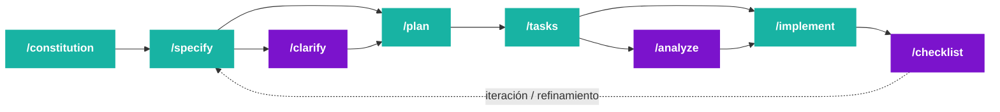

# Charla GenAI UTN — Material

> Fuente inicial: `Charla-GenAI-UTN-Material.docx`  
> Estado: primera versión editada y estructurada en Markdown.  
> Objetivo: material base para preparar charla, slides, speaker notes y demos.

## Título

**Diseñando el futuro del desarrollo con GenAI**

Cómo dirigir agentes de desarrollo para generar software escalable, predecible y de calidad.

Técnicas que usan equipos de ingeniería modernos: **Context Engineering**, **Spec-Driven Development**, **evaluación de agentes** y **orquestación**.

## Oradores

- **Alan Julián De Angelis** — GenAI Technical Leader, Mercado Libre.
- **Luciano Rodriguez** — GenAI Software Engineer, Mercado Libre.

## Índice

1. [Introducción](#introducción)
2. [Apertura: el nuevo ciclo de desarrollo](#1-apertura-el-nuevo-ciclo-de-desarrollo)
3. [Por qué la IA sola no alcanza](#2-por-qué-la-ia-sola-no-alcanza)
4. [Niveles de profesionalismo para desarrollar con agentes](#3-niveles-de-profesionalismo-para-desarrollar-con-agentes)
5. [Context Engineering](#4-context-engineering)
6. [Spec-Driven Development](#5-spec-driven-development-sdd)
7. [Evals](#6-evals)
8. [Orquestación de agentes](#7-orquestación-de-agentes)
9. [Cierre](#8-cierre)
10. [Referencias](#9-referencias)

---

# Introducción

El rol del ingeniero de software evolucionó con la llegada de la IA generativa: de escribir código a **diseñar contexto**, **dirigir agentes** y **tomar decisiones de mayor valor**.

La tesis central de la charla es que el valor de desarrollar software de calidad se duplicó, porque ahora no alcanza con dominar ingeniería de software: también hay que aprender a dirigir los agentes que ejecutan parte de ese trabajo.

> **Tesis central:** “El valor de desarrollar software de calidad se ha duplicado.”

---

# 1. Apertura: el nuevo ciclo de desarrollo

Hoy contamos con una nueva capa de abstracción: **agentes de IA capaces de escribir, modificar, probar y revisar código**.

Pero esta nueva capa abre dos caminos muy distintos.

## Los dos caminos

### Camino fácil: vibe-coding

Delegar tareas al agente con prompts simples y esperar que “resuelva”.

En la práctica suele traer:

- muchas iteraciones;
- calidad por debajo de lo esperado;
- pérdida de contexto;
- correcciones largas;
- soluciones que funcionan en aislamiento pero no encajan bien en el sistema real.

### Camino que escala: desarrollo estructurado

Trabajar con:

- especificaciones como contrato;
- evaluaciones que midan calidad;
- contexto diseñado explícitamente;
- comandos y flujos repetibles;
- revisión humana en puntos críticos;
- agentes orquestados según rol y objetivo.

## Mensaje clave

El valor del software de calidad se duplicó porque el ingeniero debe estar en los detalles y pensar tanto en el producto como en lo técnico.

La nueva responsabilidad es preparar a esta capa de abstracción para que construya exactamente lo que se necesita, sin degradar la salud del sistema.

---

# 2. Por qué la IA sola no alcanza

Los agentes de IA, usados de forma aislada, tienen límites que impiden entregar software de calidad por sí solos.

## Límites principales

### Ventana de contexto limitada

No pueden ver el sistema completo. Trabajan con fragmentos y no siempre entienden la arquitectura global del producto.

### Capacidades acotadas

Pueden generar código correcto en aislamiento, pero desconocen reglas de negocio, restricciones reales y decisiones previas del equipo.

### Conocimiento empresarial ausente

No conocen integraciones internas, APIs legacy ni decisiones de diseño que solo el equipo maneja.

### Producto ≠ código

Un buen producto necesita visión de conjunto: UX, escalabilidad, mantenibilidad, observabilidad y trade-offs técnicos. Los agentes no piensan automáticamente como product engineers.

## Conclusión

La IA puede acelerar el desarrollo, pero no reemplaza la ingeniería. Sin contexto, sin especificaciones y sin validación, solo acelera la producción de deuda técnica. Un destino pintoresco, aunque poco recomendable.

---

# 3. Niveles de profesionalismo para desarrollar con agentes

Una forma práctica de entender la adopción de agentes es pensarla como una pirámide de madurez: en la base está el uso conversacional, y a medida que se asciende aparecen contexto persistente, validación, loops, grafos y orquestación.

La pirámide tiene dos fuerzas que crecen en paralelo:

- **Madurez del contexto:** cuánto entiende el agente del proyecto, del negocio, de las reglas y de la historia técnica.
- **Madurez de la ejecución:** qué tan bien puede planificar, actuar, validar, iterar y coordinarse con otros agentes.


> **Idea clave:** cuanto más arriba se está en la pirámide, más confianza se puede delegar en el agente. Esa confianza no nace de la fe en el modelo, sino de mejores restricciones, mejor contexto y mejores señales de validación.

## Nivel 0 — Chat-driven coding

Uso inicial de un coding agent como Claude, Codex, Cursor o similares, sin un harness preparado.

**Hay:**

- conversación directa con el agente;
- explicación manual de la tarea;
- feedback humano constante;
- validación principalmente visual o manual;
- productividad inicial alta para tareas simples.

**No hay:**

- contexto persistente del proyecto;
- rules, `AGENTS.md` o `CLAUDE.md`;
- plan formal antes de implementar;
- comandos de validación definidos;
- memoria de decisiones previas;
- límites claros de permisos o herramientas.

Es el nivel del **vibe-coding**: útil para empezar, peligroso si se confunde velocidad con calidad. El agente puede avanzar rápido, pero también puede acelerar deuda técnica con admirable entusiasmo.

## Nivel 1 — Planificación y selección consciente de modelos

El usuario empieza a dirigir el trabajo: primero se planifica, luego se ejecuta. También se elige el modelo según el tipo de tarea.

**Hay:**

- uso de plan mode antes de tocar código;
- división de tareas complejas en pasos verificables;
- elección consciente entre modelos rápidos, balanceados y de máxima capacidad;
- revisión humana frecuente antes de implementar;
- mayor control sobre costo, velocidad y profundidad de razonamiento.

**No hay:**

- workflows reutilizables;
- automatización del proceso;
- memoria estable del proyecto;
- integración profunda con herramientas externas;
- validación sistemática más allá de lo que el usuario pida manualmente.

Ejemplos de elección de modelos:

- **Pregunta simple:** “¿Dónde está definida esta función?” o “¿Qué comando corre los tests?” → modelo rápido/barato.
- **Tarea repetitiva:** “Agregá tests similares para estos tres casos” o “Actualizá este patrón en varios archivos” → modelo balanceado.
- **Tarea compleja:** “Diseñá la migración de este módulo sin romper compatibilidad” o “Investigá un bug intermitente de producción con impacto arquitectónico” → modelo de máxima capacidad.

## Nivel 2 — Rules, MCPs, skills y assets reutilizables

El trabajo deja de depender exclusivamente del prompt del momento. Se empiezan a empaquetar reglas, herramientas y conocimiento operativo.

**Hay:**

- rules de comportamiento y estilo;
- archivos como `AGENTS.md` o `CLAUDE.md`;
- MCPs para conectar herramientas externas;
- skills para workflows repetidos;
- assets, templates, scripts y checklists;
- instrucciones reutilizables para testing, debugging, documentación o code review.

**No hay:**

- harness completo y mantenido como parte central del proyecto;
- contexto de negocio suficientemente vivo;
- estrategia clara de memoria a largo plazo;
- observabilidad profunda del proceso del agente;
- autonomía confiable para tareas largas.

La diferencia central es que el conocimiento empieza a dejar de estar solo en la cabeza del developer y pasa a vivir en artefactos que el agente puede reutilizar.

## Nivel 3 — Harness propio del proyecto

El proyecto ya tiene un entorno diseñado para que el agente trabaje bien. Acá aparece con más fuerza el **Context Engineering**.

**Hay:**

- harness propio del repo;
- contexto vivo del proyecto;
- documentación técnica relevante;
- reglas de negocio;
- comandos de validación;
- criterios de arquitectura;
- subagents para investigación, testing, documentación o revisión;
- hooks para ejecutar acciones determinísticas en momentos críticos.

**No hay:**

- memoria externa amplia tipo second brain;
- recuperación histórica sofisticada;
- loops o grafos diseñados explícitamente para tareas largas;
- orquestación multi-agente completa;
- autonomía alta sin supervisión humana.

En este nivel la persona sigue validando activamente, pero el agente ya opera con un mapa mucho más fiel del proyecto. El salto de calidad no viene de “prompt mágico”, sino de darle al agente un entorno menos improvisado.

## Nivel 4 — Second brain y conocimiento externo conectado

El agente deja de depender solo del repo y puede consultar una base de conocimiento viva: Obsidian, Notion, Google Drive, ADRs, RFCs, research notes o documentación interna.

**Hay:**

- conexión con un second brain;
- acceso a decisiones pasadas;
- contexto de negocio persistente;
- investigación acumulada;
- documentación histórica;
- posibilidad de recuperar aprendizajes entre sesiones.

**No hay:**

- garantía automática de calidad del conocimiento recuperado;
- loops autónomos robustos;
- coordinación multi-agente avanzada;
- validación completa sin intervención humana.

Este nivel aumenta la confianza porque el agente puede trabajar con historia, no solo con instrucciones del momento. Pero exige curaduría: una base de conocimiento desordenada no es memoria, es ruido con pretensiones académicas.

## Nivel 5 — Loop engineering y graph engineering

El foco pasa de “qué contexto tiene el agente” a “cómo ejecuta”. Se diseñan ciclos y topologías explícitas para resolver tareas largas o ambiguas.

**Hay:**

- loops de ejecución: analizar → actuar → observar → validar → corregir;
- condiciones de salida verificables;
- retries y presupuestos de iteración;
- manejo de fallos;
- trazas del proceso;
- grafos con nodos, estados, ramas y handoffs;
- evals o checks como parte del flujo.

**No hay:**

- necesariamente múltiples agentes especializados;
- coordinación distribuida compleja;
- confianza plena sin monitoreo;
- reemplazo del criterio humano en decisiones críticas.

La frase importante para este nivel:

> Un agente serio no termina cuando deja de hablar. Termina cuando una condición verificable se cumple.

## Nivel 6 — Orquestación de agentes

El nivel superior es diseñar un sistema donde múltiples agentes trabajan con roles, límites y responsabilidades claras.

**Hay:**

- agentes especializados por rol;
- paralelización de tareas;
- handoffs entre agentes;
- separación entre planificación, implementación, testing y revisión;
- agentes revisores o críticos;
- coordinación de costos, permisos y contexto;
- mayor confianza operativa basada en validación y trazabilidad.

**No hay:**

- magia;
- garantía de calidad por sumar más agentes;
- independencia total del diseño humano;
- reemplazo de arquitectura, producto o criterio técnico.

Orquestar agentes no significa sumar inteligencia de forma lineal. Significa diseñar coordinación. Un solo agente bien equipado puede ser mejor que cinco agentes mal coordinados corriendo en direcciones distintas, una imagen épica, pero poco recomendable para producción.

## Lectura de la pirámide

Los primeros niveles fortalecen la **madurez del contexto**: el agente entiende mejor qué debe hacer, con qué reglas, en qué proyecto y con qué conocimiento.

Los niveles superiores fortalecen la **madurez de la ejecución**: el agente no solo entiende mejor, sino que trabaja con loops, validación, coordinación y trazabilidad.

La profesionalización ocurre cuando se combinan ambas dimensiones:

> mejor contexto para decidir, mejor ejecución para actuar y mejor validación para confiar.

---

# 4. Context Engineering

**Context Engineering** es la práctica de diseñar el contexto del agente: el harness que lo hace útil y le permite trabajar de forma consistente.

En vez de pensar solo en prompts aislados, se diseña un sistema completo alrededor del agente.

## Las 6 herramientas del harness

### 1. Rules

Políticas que debe respetar el agente.

Ejemplos:

- estilo de código;
- convenciones del proyecto;
- restricciones de seguridad;
- criterios de arquitectura;
- principios del equipo.

Las rules dan contexto general sin definir cada paso.

### 2. Commands

Pasos determinísticos para resolver problemas concretos.

Ejemplo:

```text
/test
/review
/create-spec
/run-evals
```

Reducen costo de tokens y tiempo porque el agente ya tiene un flujo definido.

### 3. MCP — Model Context Protocol

Contexto externo y dinámico.

Permite conectar al agente con:

- bases de datos;
- APIs;
- herramientas internas;
- documentación viva;
- sistemas de monitoreo;
- repositorios o servicios externos.

Es muy potente, aunque puede consumir muchos tokens si no se diseña con cuidado.

### 4. Subagents

Colaboradores especializados para tareas específicas.

Ejemplos:

- agente de testing;
- agente de revisión;
- agente de documentación;
- agente de análisis de impacto;
- agente de migración.

Se pueden paralelizar y evitan ensuciar la ventana de contexto principal.

### 5. Skills

Habilidades auto-invocadas: kits de flujos, reglas y utilidades que el agente activa según el contexto.

Sirven para reutilizar lógica compleja sin reescribirla en cada prompt.

### 6. Hooks

Scripts determinísticos que se ejecutan en momentos específicos del flujo del agente.

Ejemplos:

- formatear código antes de finalizar;
- ejecutar tests después de editar;
- bloquear cambios inseguros;
- pedir aprobación humana antes de modificar producción.

Los hooks aseguran estándares y permiten human-in-the-loop en puntos críticos.

## Gestión de conversaciones

El historial de una conversación es una “aspiradora de tokens”: cuanto más crece, más caro y menos preciso se vuelve el agente.

Buenas prácticas:

- abrir un nuevo chat por tarea;
- resumir el contexto en vez de arrastrar todo el historial;
- separar scripts determinísticos del razonamiento generativo;
- usar prompt reviewers para refinar instrucciones;
- diseñar agent loops cuando la tarea requiere iteración;
- definir goals verificables para que el agente sepa cuándo terminó.

## Secuencia efectiva

El orden recomendado para ejecutar bien una tarea:

1. Analizar el problema.
2. Escribir la especificación.
3. Generar el plan.
4. Validar humanamente.
5. Implementar.
6. Medir el resultado.
7. Ajustar y repetir si hace falta.

---

# 5. Spec-Driven Development (SDD)

**Spec-Driven Development** es un marco de trabajo para proyectos complejos con IA.

Su principio central:

> Las especificaciones son el artefacto principal; el código es una consecuencia.

## ¿Qué es SDD?

### Specs primero

Se usa lenguaje natural como lenguaje de programación.

Primero se define el **QUÉ** debe hacer el sistema. Luego se decide el **CÓMO** lo implementará el agente.

### Fuente de verdad única

Las specs son el contrato que guía a todos los involucrados:

- developers;
- QA;
- product managers;
- agentes de IA;
- reviewers.

### La IA ejecuta

Una vez escritas, las specs se convierten en instrucciones precisas para que el agente genere, pruebe y valide el código de forma estructurada.

## Las 3 etapas y el ecosistema

El flujo se organiza en tres etapas:

1. **Constitution**
2. **Specify + Plan**
3. **Tasks + Implement**

Herramientas del ecosistema:

- spec-kit;
- GSD;
- BMAD;
- openSpec.

## Flujo SDD recreado en Mermaid

El documento original incluía un diagrama del flujo de comandos. Esta es una versión recreada en Mermaid para mantenerlo versionado y editable dentro del repo.

> Referencia visual extraída del DOCX: [`assets/original-diagram.png`](../assets/original-diagram.png)



### Lectura del flujo

- **/constitution** define principios, filosofía técnica y reglas no negociables.
- **/specify** captura el QUÉ de la necesidad.
- **/clarify** permite resolver ambigüedades antes de avanzar.
- **/plan** transforma la spec en estrategia técnica.
- **/tasks** descompone el plan en unidades ejecutables.
- **/analyze** revisa consistencia, riesgos y completitud.
- **/implement** ejecuta el trabajo.
- **/checklist** valida que el resultado cumpla con los criterios esperados.
- El loop de refinamiento vuelve a **/specify** cuando la validación detecta gaps.

## Demo — spec-kit en acción

Demostración en vivo de cómo desarrollar software desde cero con spec-kit.

Flujo sugerido:

1. Ejecutar `specify init` para inicializar el proyecto.
2. Elegir el agente.
3. Elegir el tipo de scripts: `sh` o `ps`.
4. Instalar los recursos del framework.
5. Usar comandos dentro del agente:
   - `/speckit.specify` para describir el QUÉ.
   - `/speckit.plan` para generar el plan.
   - `/speckit.tasks` para descomponer el trabajo.
   - `/speckit.implement` para ejecutar.
6. Observar cómo el agente mantiene coherencia a lo largo del flujo.

## Buenas prácticas y consideraciones

### Definir filosofía y método de trabajo en la constitution

El archivo `constitution.md` debe ir más allá del estilo de código.

Debe encapsular:

- filosofía del equipo;
- valores técnicos;
- acuerdos metodológicos;
- reglas no negociables;
- criterios de calidad.

Ejemplos:

- priorizar simplicidad;
- exigir pruebas unitarias para toda nueva funcionalidad;
- usar arquitectura serverless;
- evitar dependencias innecesarias;
- mantener backward compatibility.

### Usar MCPs o rules desde el inicio

Dentro de la constitution se deben establecer principios claros para el uso de MCPs o rules esenciales.

Esto permite que el agente tenga contexto propio del negocio desde las primeras iteraciones.

### Iterar y refinar artefactos rigurosamente

Como la especificación es el nuevo código, es obligatorio revisar e iterar sobre:

- `spec.md`;
- `plan.md`;
- `tasks.md`.

Comandos como `/clarify` y `/analyze` ayudan a asegurar claridad, precisión y completitud antes de autorizar la implementación.

### Centralizar y versionar documentación

Toda la documentación fundamental del proyecto y los artefactos SDD deben guardarse en una ubicación centralizada, típicamente dentro de `/specs`.

Esto simplifica la gestión, asegura que la IA acceda a la fuente de verdad correcta y facilita el versionamiento con Git.

### Actualizar documentos existentes

Al agregar features o correcciones, no conviene crear nuevos archivos si ya existe uno relevante.

Es preferible actualizar los `.md` existentes y gestionar esos cambios con Git.

Esto mantiene trazabilidad histórica y evita redundancia de contexto.

### Cuidar recursos y ventana de contexto

SDD puede elevar considerablemente el consumo de tokens o créditos por la cantidad de documentación y tareas largas.

Para mitigarlo:

- escribir prompts claros;
- documentar de forma precisa;
- usar comandos correctamente;
- elegir modelos adecuados;
- dividir problemas complejos;
- compactar contexto cuando corresponda.

### No modificar templates internos de spec-kit

No se deben modificar directamente los archivos y scripts base generados por Spec Kit.

Esto incluye:

- `/.specify/templates`;
- `/.specify/scripts`;
- archivos de configuración internos;
- comandos internos del paquete del agente elegido.

La integridad de estos componentes es clave para un flujo SDD predecible.

---

# 6. Evals

Un **eval** es un proceso donde se somete a un agente —junto con todo su harness— a un conjunto de pruebas diseñadas para calificar criterios específicos.

Dada una entrada o prompt, se espera cierto comportamiento o salida.

## Qué buscamos evaluar

### Eje 1 — Calidad de la salida

**Comportamiento**

- ¿El agente comprende la completitud del problema?
- ¿Identifica requisitos explícitos e implícitos?
- ¿Respeta restricciones del sistema?

**Evaluación exacta**

- ¿El resultado compila?
- ¿Pasan los tests unitarios?
- ¿Se cumplen contratos de API?
- ¿No se introducen regresiones?

**Evaluación subjetiva**

- ¿La respuesta abierta del agente está dentro del rango esperado?
- ¿La solución es mantenible?
- ¿El diseño es razonable?
- ¿La implementación respeta criterios del equipo?

### Eje 2 — Calidad del proceso

**Uso de herramientas**

- ¿Utiliza las herramientas que queremos que use?
- ¿Consulta documentación cuando corresponde?
- ¿Ejecuta tests antes de finalizar?

**Estados intermedios**

- ¿Pasa por los estados esperados?
- ¿Primero analiza, luego planifica y recién después implementa?
- ¿Pide aclaraciones cuando faltan datos críticos?

**Eficiencia**

- ¿Reduce tiempos?
- ¿Reduce costo de iteración?
- ¿Disminuye retrabajo?
- ¿Mejora la predictibilidad?

## Mensaje clave

Sin evals, no hay mejora sistemática. Solo hay percepción subjetiva de que “el agente anda mejor”. Y la percepción, como suele suceder, es un pésimo sistema de monitoreo.

---

# 7. Orquestación de agentes

## Agent Loop

El ciclo de razonamiento de un agente puede pensarse así:

1. Percibe contexto.
2. Decide una acción.
3. Ejecuta.
4. Observa el resultado.
5. Razona nuevamente.
6. Repite hasta cumplir el objetivo.

Entender este loop es clave para diseñar sistemas autónomos y predecibles.

## Orquestación multi-agente

Se pueden delegar tareas a múltiples agentes y coordinarlos en paralelo, con roles diferenciados.

Ejemplos de roles:

- agente de implementación;
- agente de testing;
- agente de code review;
- agente de documentación;
- agente de investigación;
- agente de migración.

## Agentes autónomos

Los agentes no tienen que ser solo reactivos.

Con cron jobs o schedulers pueden ejecutarse de forma programada:

- revisiones nocturnas;
- generación de reportes;
- pipelines de QA;
- monitoreo continuo;
- análisis de deuda técnica;
- actualización de documentación.

Así, el agente deja de ser solo una herramienta interactiva y pasa a comportarse como un proceso del sistema.

## Tres casos prácticos

### Caso 1 — Feature nueva

Se necesita construir un endpoint con validaciones, lógica de negocio y tests.

Una orquestación posible:

- agente de desarrollo;
- agente de tests;
- agente de code review.

Desarrollo y tests pueden correr en paralelo. La revisión espera a que ambos terminen.

### Caso 2 — Contexto de una API externa

Un agente necesita consultar una API legacy de alta latencia.

Solución:

- un subagente o skill carga ese contexto de forma independiente;
- el agente principal recibe solo el resumen útil;
- la ventana de contexto principal se mantiene limpia.

### Caso 3 — Migración de múltiples servicios

Se deben migrar 8 microservicios a una nueva versión con breaking changes.

Solución:

- lanzar 8 agentes en paralelo;
- uno por servicio;
- compartir una spec común;
- validar cada migración con tests y checks específicos.

La orquestación también es escala horizontal, no solo división por roles.

---

# 8. Cierre

> “Context is the new code.”

El contexto que le damos al agente —reglas, specs, evaluaciones y orquestación— es hoy tan determinante como el código mismo.

Dominar el harness es lo que separa el vibe-coding del desarrollo estructurado, predecible y escalable.

## Ideas fuerza para cerrar

- La IA acelera, pero no reemplaza criterio técnico.
- El prompt aislado no escala; el sistema de contexto sí.
- Las specs son contratos ejecutables para humanos y agentes.
- Los evals convierten intuición en medición.
- La orquestación permite pasar de asistente individual a sistema de desarrollo.
- El ingeniero del futuro diseña el entorno donde los agentes trabajan bien.

---

# 9. Referencias

- Skills.sh — Directorio de skills curadas para agentes de IA.  
  <https://www.skills.sh/>

- GitHub Spec Kit — Toolkit open source para Spec-Driven Development.  
  <https://github.com/github/spec-kit>

- Documentación de Spec Kit — Guía de uso del toolkit y sus comandos.  
  <https://github.github.com/spec-kit/>

- GitHub Blog: Spec-Driven Development with AI.  
  <https://github.blog/ai-and-ml/generative-ai/spec-driven-development-with-ai-get-started-with-a-new-open-source-toolkit/>

- Anthropic — Effective context engineering for AI agents.  
  <https://www.anthropic.com/engineering/effective-context-engineering-for-ai-agents>

- Anthropic — Writing effective tools for AI agents.  
  <https://www.anthropic.com/engineering/writing-tools-for-agents>

- Claude Code — Changelog.  
  <https://github.com/anthropics/claude-code/blob/main/CHANGELOG.md>

- Model Context Protocol — Documentación oficial.  
  <https://modelcontextprotocol.io>

- Anthropic — News.  
  <https://www.anthropic.com/news>
